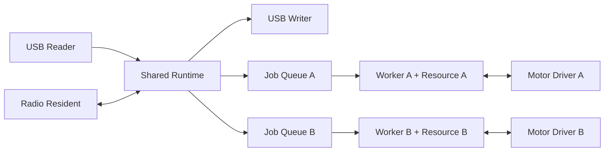

# Feather RP2040 Board And Firmware

## Hardware And GPIO Safety

Every firmware image declares its physical attachments before the board
constructs shared buses. Declaration is an assertion about actual wiring, not
auto-detection. A successful I2C transaction cannot identify a complete wing
stack or prove that its other pins are compatible.

### Built-In Images

| Image                             | Declared hardware                 | Auxiliary outputs          |
| --------------------------------- | --------------------------------- | -------------------------- |
| Gateway                           | Onboard radio, TFT FeatherWing V2 | None                       |
| Rotator                           | Onboard radio, Motor FeatherWing  | None                       |
| Sidecar                           | Onboard radio, OLED FeatherWing   | GPIO 1 = D11, GPIO 2 = D12 |
| Any image with `hardware-unknown` | USB diagnostics only              | None                       |

Sidecar's two pins start high impedance with no pulls. Commands can select
high impedance, push-pull high or push-pull low. Output drive strength is 2 mA;
this setting is not an overcurrent cutoff. IDs 3 and 4 address D24 and D25 but
are not allocated by any built-in image. Gateway and Rotator reject every
auxiliary GPIO command. A node's status reports `auxiliary_gpio_access`
separately from `auxiliary_gpio`, so an unavailable pin is never presented as
an available input merely because its last reported auxiliary mode is high
impedance.

### Fixed Node Hardware

Each binary declares its wing through the Rust `wings::Wing` catalog:
Gateway uses TFT V2, Rotator uses Motor, and Sidecar uses OLED. Ordinary build
and flash tasks always use these declarations; there are no display-selection
feature flags. A different physical stack requires changing its declaration.

```sh
mise run build --profile release
mise run package --profile release

# Diagnostic Override: No Shared-Header Buses, Probing, Or GPIO Outputs.
mise run build --hardware-unknown
mise run package --profile dev
```

The diagnostic override is limited to the development profile. Flash an
existing image explicitly through `mise run dev:cli -- flash <image.uf2>`.
UF2 paths are reused, so retain diagnostic builds separately if needed.
CI packages normal images.

### Declaring Custom Wiring

Composition roots build a `Hardware` declaration and call `validate()` before
`Board::start`. Wing definitions live in the board crate, alongside the pin
mapping they describe. Portable display and motor behavior remains in
`helios-mesh-drivers`.

```rust
let hardware = board::Hardware::new()
    .tft(board::wings::TftV2::standard())
    .auxiliary(AuxGpioId(1), board::Auxiliary::PushPull {
        initial: AuxGpioMode::HighImpedance,
        drive: board::Drive::Ma2,
    })
    .validate()?;
```

Declare every electrical participant, including an unused SD slot: its
chip select still needs a defined idle when another device uses SPI. TFT V2
standard wiring reserves D9 (TFT select), D10 (data/command), D6 (touch IRQ),
D5 (SD select), shared SPI and I2C. Jumper changes must be reflected in the
wing declaration. The complete plan is checked against the onboard radio and
other declarations before it changes any pad. A TFT and OLED using their
standard D9 pins conflict and cannot start together.

Only validated, owned TFT/OLED/motor bundles can be taken from the board. They
expose presence checks and panel construction without exposing mutable raw
GPIO handles. A failed presence check never tries a different display driver
and never frees pins for auxiliary use. Dropping an unused bundle retains its
idle configuration. Peripheral residents are still explicitly spawned by the
composition root.

### Controlling Sidecar Through Gateway

With the gateway connected over USB:

```sh
mise run dev:cli -- nodes
mise run dev:cli -- --node <sidecar-id> status
mise run dev:cli -- --node <sidecar-id> gpio 1 high
mise run dev:cli -- --node <sidecar-id> gpio 2 low
mise run dev:cli -- --node <sidecar-id> gpio 1 high-z
mise run dev:cli -- --node <sidecar-id> gpio-pulse 1 1000
```

These are ordinary node requests forwarded over LoRa; there is no separate
GPIO forwarding service. The Sidecar board checks allocation after the normal
request validation and write-binding admission. Direct USB commands reach the
same board check. Rejections distinguish invalid IDs, unallocated pins,
reserved pins and unsupported modes. Every rejection leaves pad state
unchanged, including a high-impedance request to a reserved pin.

#### Firmware-Timed Pulses

`SidecarNode::pulse_gpio` queues a job on the selected pin's independent worker.
The job drives high, awaits its local timer, then cleanup drives low. Admission
returns an operation handle; `completed()` waits through cleanup. Closing the
host or losing radio communication does not cancel the job.

```rust
use helios_mesh::{AuxGpioId, ConnectedNode, DeviceSelector, GatewayNode, NodeId};
use std::time::Duration;

let gateway = GatewayNode::connect(DeviceSelector::Only).await?;
let ConnectedNode::Sidecar(sidecar) = gateway.connect_node(NodeId(123_456)).await? else {
    return Err(helios_mesh::Error::Unsupported);
};
let operation = sidecar.pulse_gpio(AuxGpioId(1), Duration::from_secs(1)).await?;
let result = operation.completed().await?;
assert!(result.cleanup_error.is_none());
```

Python uses `await sidecar.pulse_gpio(helios_mesh.AuxGpioId(1), timedelta(seconds=1))`.
Durations must be whole milliseconds from 1 through 60,000. A pin token comes
only from `Board::take_auxiliary`, once, after wiring validation. Every drive
still checks the board's allocation. A mode change while the worker holds the
pin returns `Busy`; additional pulses can queue up to the worker's fixed bound.
The other pin remains independently controllable. After a pulse the pin stays
low, including cancellation cleanup; it does not restore the earlier mode.

A replayed radio request returns its original operation ID without scheduling
another pulse. A host timeout leaves admission uncertain: a new request ID
would create new work. Worker history is boot-local and bounded.

### Electrical Limits

The earlier TFT investigation identified SPI contention as a likely failure
mechanism: an active chip select could let an unconfigured display consume
radio traffic and drive MISO. Firmware tests do not establish the physical
cause of damage to an individual board. The board
preserves the startup fix: park all header pads before bus creation and keep
declared active-low selects deasserted. Output transitions set the latch
before enabling the output. Unknown mode omits shared-bus construction.

This prevents firmware from authorizing contradictory uses of declared pins.
It does not prove that the connected hardware matches its declaration, detect
short circuits, handle hot-plugging, protect against overvoltage, or control
pins before firmware runs. Firmware cannot make arbitrary FeatherWings
universally safe. A protected interposer with default-disabled isolation and
appropriate fault containment is a separate hardware requirement.

The protocol version changes when the GPIO status/error encoding changes;
all participating boards and the host must use matching firmware. The Cargo
and reported firmware version remain `0.1.0` during development.

## Motor Setup

The tested Rotator stack uses Adafruit Motor FeatherWing product 2927 at I2C
address `0x60` with Adafruit product 324 motors: 12 V, 350 mA, 200-step NEMA-17.
Connect motor power to the FeatherWing motor-power terminal. Each channel holds
its microstep mode, absolute speed and acceleration limits, movement and hold
duty, and electrical direction for the current boot. The host pushes these
definitions after connection. Individual operations may request lower speed
or acceleration without changing the active limits.

Position is an open-loop estimate. Without encoders or limit switches, physical
position at boot is unknown; home every channel after every restart before
commanding movement. The Python sweep and tuning examples operate real motors.

## Identity, Indicators, And Radio

Each board derives a stable six-digit ID from its onboard flash unique ID.
The ID survives firmware updates without provisioning. The onboard NeoPixel
uses slow blue breathing for ready, a brief dim cyan tick for protocol traffic,
and three magenta pulses for identification.

The proof-of-concept RFM95 link uses 869.525 MHz, spreading factor 7, 250 kHz
bandwidth, coding rate 4/5, and 10 dBm output power. This configuration assumes
operation in Liechtenstein; deployment elsewhere requires checking local
spectrum rules. Attach suitable antennas before powering radio firmware.

## Firmware Packages And Flashing

Linux Build produces matching-profile ELF fixtures under
`target/fixtures/firmware/`. Package converts those bytes to UF2 and assembles
`target/package/firmware/helios-mesh-firmware-feather-rp2040.zip` without
recompiling. The archive contains:

```text
LICENSE-APACHE
README.txt
helios-mesh-node-gateway.uf2
helios-mesh-node-rotator.uf2
helios-mesh-node-sidecar.uf2
debug/
  helios-mesh-node-gateway.elf
  helios-mesh-node-rotator.elf
  helios-mesh-node-sidecar.elf
```

The README identifies the profile, role hardware, and flashing procedure. ELF
files retain the exact build's symbols for diagnostics; UF2s are the flashable
images. Individual UF2s remain beside the ZIP for local flashing. Release asset
names include the version and Linux native target, identifying the build host;
the actual firmware target is Feather RP2040. Host CLI downloads and Python
wheels remain separate. Release-level `SHA256SUMS` and `release.json` cover the
firmware archive with the other assets.

Flash one board at a time. A blank board enters BOOTSEL by holding BOOTSEL
while connecting USB. A compatible running node can enter the same mode with
`mise run dev:cli -- --device <id> restart --bootloader`. Copy the selected
role's UF2 to the mounted `RPI-RP2` volume, or run:

```sh
mise run dev:cli -- flash target/package/firmware/helios-mesh-node-sidecar.uf2
```

The CLI refuses to copy unless exactly one BOOTSEL volume is mounted.
`mise run dev:cli -- --device <id> flash <image.uf2>` combines the selected
node's bootloader restart, volume wait, copy, and post-flash status check.
After flashing, inspect `status`, `describe`, and, for a Gateway, `nodes`.
Protocol changes require matching hosts and firmware on every board; see
[Flashing Across A Protocol Bump](#flashing-across-a-protocol-bump).

## Authoring A Node

### Error Boundaries

Each firmware library exports `Error` and `Result<T>`. Domain errors stay in their
own modules and become typed causes at crate boundaries. Board hardware
validation, driver connection, boot registration, and firmware display
composition return their owning crate's root error.

`helios_mesh_core::Error<E>` retains a flash device's concrete error without allocation;
`E` must implement `Debug` and be `'static` when wrapped at that boundary.
`JobOutcome` keeps primary and cleanup outcomes separately. Its `into_result()`
retains both failures in `Error::Job`, and reports a cleanup-only failure as
`Error::Cleanup`; wire operation snapshots keep their existing state rules.

Published HAL and radio errors that expose only `Debug` remain typed terminal
causes. Radio failures retain the original `lora_phy::RadioError` rather than
collapsing every cause into one marker. Root errors use `thiserror` without
requiring `std`. The Python adapter translates host errors into its existing
`HeliosMeshError` exception hierarchy.

Native firmware tests use `defmt`'s byte-capture test runtime through development
dependencies. RP2040 images use `defmt-rtt` through the normal firmware graph.

A node implements `helios_mesh::Node`. Its typed routes submit ordinary job structs to
independent channels. The shared runtime owns the protocol entry points, transport
rules, replay protection, and diagnostics. Firmware authors depend on `helios_mesh`
with `default-features = false` and `features = ["firmware"]`.

### Sidecar

The Sidecar declares one channel per GPIO:

```rust
#[helios_mesh::node]
pub struct Sidecar {
    channel_1: Channel<Jobs, AuxiliaryPin>,
    channel_2: Channel<Jobs, AuxiliaryPin>,
}
```

`Channel<Jobs, Resources>` owns a bounded queue and its resource value. The job
catalog's associated resource type must match the channel's resource type; Rust
rejects a mismatch. Channels execute independently, with sequential jobs within
each channel. `#[helios_mesh::node]` generates permanent storage, worker tasks, startup,
and the Node::channels() enumeration. There are no authored statics, worker IDs, handles, or
runners for this wiring.

The generated constructor starts each worker once:

```rust
let sidecar = Sidecar::start(
    spawner,
    board.take_auxiliary(AuxGpioId(1)).ok(),
    board.take_auxiliary(AuxGpioId(2)).ok(),
);
```

Each argument accepts the resource itself or `Option<Resource>`. `None` creates
an unavailable channel for diagnostic/degraded operation: submission and direct
access return `Unavailable`. No pin token exists unless the board granted it.
Channel IDs follow field declaration order, starting at one; preserve that order
when retaining the node's external channel numbering. Optional third and fourth
parameters set queue and history capacities: `Channel<Jobs, Resources, 4, 128>`.
The macro requires a concrete named struct (or a unit struct for a node without
channels). Ordinary fields are supported too: their values are passed directly
to the generated constructor, while channel arguments supply channel resources. One node instance is initialized per firmware boot.

The complete implemented Sidecar is:

```rust
--8<-- "crates/firmware/helios-mesh-nodes/src/nodes/sidecar/mod.rs"
```

Its composition root, `crates/firmware/helios-mesh-nodes/src/bin/sidecar.rs`, declares OLED
wiring and two auxiliary pins, validates that plan, starts the board, initializes
Sidecar, and starts the shared runtime residents.

### Node Identity And Channel Management

Each implementation declares its fixed catalog type:

```rust
#[helios_mesh::node]
impl helios_mesh::Node for Sidecar {
    type Config = ();
    const NODE_TYPE: helios_mesh::NodeType = helios_mesh::NodeType::Sidecar;

    // Typed routes...
}
```

The catalog owns `identifier`, `label`, and `description`. The runtime owns the
instance's distinct `NodeId`; two Sidecars share a type but have different device
identities. Handlers read their device ID through `Context::node_id()`.
There is no separate `Profile` or duplicated status-row schema.
Live status rows are supplied through `Node::status()`.

`Node::channels()` returns borrowed `helios_mesh::ChannelRef` views in declaration order.
It neither allocates storage nor starts tasks. A node without channels returns
an empty iterator. Each view exposes `id()`, the source field `name()`,
`is_available()`, `is_idle()`, `queued()`, operation `status()`/`snapshot()`,
and `cancel()`/`cancel_all()`. The field name is diagnostic metadata, not a
human-readable catalog label. Queue length excludes active work.

```rust
use helios_mesh::Node;

for channel in node.channels() {
    if channel.is_available() {
        channel.cancel_all();
    }
}
```

Shared operation lookup and cancellation use this enumeration through the
default Node methods. Submission remains typed, through the original fields.
Different channels can accept different job catalogs and custom resource types:

```rust
#[helios_mesh::node]
pub struct Instrument {
    motor: helios_mesh::Channel<MotorJobs, MotorResources>,
    display: helios_mesh::Channel<DisplayJobs, DisplayResources>,
}
```

Submitting a motor job to the display channel fails at compile time. Use smaller
catalogs when a channel should accept only a subset of jobs; job implementations
can be reused across catalogs when their resource types match.

### A Node-Owned Job Catalog

Register jobs with one enum entry. The macro declares the snake_case sibling
module and re-exports its job type; do not repeat those declarations by hand.
All jobs in one catalog use the same resource type.

The macro also generates `From<JobType>` for the catalog, so handlers submit
job structs directly:

```rust
let operation = self.channel(request.gpio)?
    .submit(Pulse::new(request.duration_ms)?)?;
```

The receiving channel determines the catalog. Explicit `Jobs::Pulse(...)` values
remain accepted; unsupported job types fail to compile. Each payload type may
appear only once in a catalog so conversion has one unambiguous destination.
Use distinct wrapper types when two variants represent different meanings.

```rust
--8<-- "crates/firmware/helios-mesh-nodes/src/nodes/sidecar/jobs/mod.rs"
```

The Pulse constructor validates the duration once, before admission. Its field
is private, so callers cannot create an invalid pulse. Resource-dependent checks
still belong in `Job::initialize()`.

The complete pulse workflow stays in one file:

```rust
--8<-- "crates/firmware/helios-mesh-nodes/src/nodes/sidecar/jobs/pulse.rs"
```

`initialize` validates under the resource lock with immutable access. Rejected
initialization and cancellation while queued do not run cleanup. Once `run`
is polled, cleanup runs once after success, failure, cancellation, or deadline expiry,
still holding the same resource lock. Cleanup receives the original result
by reference; its error is retained separately and cannot overwrite that result.

The channel's generated worker remains alive for the firmware lifetime. Cancel
through the returned `JobOperation` or the host operation API; never abort the
resident. `submit` returns immediately or refuses with `Busy`. Default capacity
is four waiting jobs and 128 history records. Finished records are evictable only
when no local operation handle retains them. Retaining every history slot causes
new admission to return `Busy`; storage never grows dynamically.

### Resources And Direct Access

Resources can be one board token or an ordinary user-authored struct:

```rust
pub struct AxisResources {
    motor: MotorChannel,
    enable: AuxiliaryPin,
}

#[helios_mesh::node]
pub struct CustomRotator {
    channel_1: Channel<AxisJobs, AxisResources>,
    channel_2: Channel<AxisJobs, AxisResources>,
}
```

Each channel retains its whole resource bundle through execution and cleanup.
A short route can call `channel.try_resources()?`; that returns `Busy` while a
job owns the resources. The async mutex is internal, allowing this direct access
without exposing synchronization generics. Distinct channels have distinct locks.

The built-in Rotator uses a `MotorChannel` resource holding its driver endpoint,
completion queue, configuration, and position state. Its `Turn`, `Home`, and
`Stop` jobs await driver completions directly. A cancelled move retains ownership
until its distinct stop acknowledgment; failed stopping leaves the motor faulted
until reboot.

### Coordinating Independent Channels

An admitted job returns a `JobOperation`. Its `id()` is used in wire responses;
its `finished()` future resolves after execution, cleanup, and resource release.
Completion uses Embassy waker registration rather than timer polling. A retained
operation handle pins its history result until that handle is dropped.

Inside a coordinator job, submit children through the runtime-owned context:

```rust
use embassy_futures::join::join;

// Inside Job::run, on a coordinator channel with its own resources:
let first = cx.submit(&channel_1, job_1)?;
let second = cx.submit(&channel_2, job_2)?;

let (first_outcome, second_outcome) =
    join(first.finished(), second.finished()).await;
```

The full workflow remains in one async function. If the second admission fails,
the parent returns an error and the runtime cancels and drains the first child.
Parent success, failure, cancellation, and deadline expiry all close the scope:
cancel every unfinished child, wait for every child's cleanup and resource
release, then run parent cleanup. Dropping a child handle does not detach it.
A child's own scoped descendants drain through the same mechanism.

The original parent execution result is preserved. Child execution or cleanup
failures are reported through the parent's `JobOutcome.cleanup`; scope-requested
child cancellation is normal. If parent cleanup also fails, its error takes
precedence. This applies even if a caller inspected a child's failure already,
so callers must inspect both the execution and cleanup outcome.

`cx.submit()` returns `Conflict` before admission when targeting the parent's
own channel. It supports different job catalogs and resource types and retains
at most `helios_mesh::MAX_JOB_CHILDREN` (eight) outstanding children. Finished children
are reaped before new submissions, so long sequential workflows reuse capacity.
An exhausted scope returns `Busy` without admitting another child.

Direct `channel.submit(job)` remains independent: parent completion and dropped
handles do not cancel it. Use that form only when the work should outlive the
submitting job. Explicit `cancel()` requests cancellation; `finished().await`
waits through cleanup.

Run coordination on a dedicated channel, outside the request dispatcher.
Self-channel rejection does not detect cycles through other channels or shared
resources. Do not hold a resource needed by a child that the parent awaits or
must drain; this also applies during parent cleanup.

`join` waits for both results; it does not reserve both queues or align physical
starts. If neither channel may start alone, admission needs a reservation or a
producer-exclusive preflight before either submission. Exact motor start alignment
needs a shared start deadline after readiness (or a hardware trigger). The built-in
Rotator retains its synchronous two-channel preflight and common requested start
time; that deadline is not a hardware simultaneity guarantee.

### Execution Deadlines

Jobs can declare a per-execution budget:

```rust
fn timeout(&self) -> Option<helios_mesh::Duration> {
    Some(helios_mesh::Duration::from_secs(5))
}
```

The default is no deadline. The job catalog forwards the concrete job's budget.
Time queued or waiting for resource access does not consume it. The deadline
starts with execution and is cooperative: it cannot preempt synchronous code.
Expiry produces `JobError::Deadline`, drains scoped children, and runs cleanup.
There are no automatic retries.

Cleanup and child draining are not timed out or cancelled. A stuck cleanup keeps
the channel busy and the operation nonterminal; software cannot safely assume
the physical resource has stopped. The unchanged wire protocol reports deadline
expiry as `Failed` with `Unavailable`, with cleanup errors separate.

Sidecar's Pulse budget is its validated pulse duration plus one second of
execution margin. This is a software execution bound, not a hardware pulse-width
guarantee.

### Typed Route Responses

A route returns a concrete payload implementing `Into<helios_mesh::Response>`; the
dispatcher performs the conversion:

```rust
#[helios_mesh::route]
async fn set_gpio(
    &mut self,
    _cx: &mut helios_mesh::Context<'_, Self>,
    request: helios_mesh::ConfigureAuxGpio,
) -> Result<helios_mesh::AuxGpioConfigured, helios_mesh::RequestError> {
    self.channel(request.gpio)?.try_resources()?.set(request.mode)?;
    Ok(helios_mesh::AuxGpioConfigured { gpio: request.gpio, mode: request.mode })
}
```

Sidecar returns `AuxGpioConfigured` and `AuxGpioPulseScheduled`. Rotator returns
`MotionConfigured`, `MotionAccepted`, and `MotionAcceptedTogether`. These
authoring types convert to the existing wire variants; host APIs and wire
encoding stay unchanged. Routes returning the complete response enum remain
supported. Forks can add concrete result types beside their wire catalogs.

### Guaranteed Entry Points And Middleware

`#[helios_mesh::node]` builds dispatch from `#[helios_mesh::route]` methods and returns
`Unsupported` when no route matches. Do not implement the generated
`Request` type or `handle_request` manually in that impl.

Describe, status, identify, diagnostics, journal, operation status,
cancellation, restart, and polling always enter through the runtime.
Operation status and cancellation use the default Node methods to search
`Node::channels()`. Explicit custom hooks can override those defaults.
GPIO and motion requests require explicit node routes. Sending a motion request
to Sidecar therefore returns `Unsupported`.

Optional `before_request(&mut Request)` and `after_response(&mut Response)`
methods provide synchronous middleware. Request rewriting runs before origin,
write-binding, and replay checks, so those gates see the rewritten request.
Use middleware for bounded inspection or transformation; put long work in jobs.
See [Request Pipeline](#request-pipeline) for ordering.

### Adding A Node In A Fork

1. Add its metadata sibling in `helios-mesh-protocol/src/nodes/`, with one
   `NodeDefinition { identifier, label, description }` constant named `DEFINITION`.
   Register one variant in `NodeType`. `#[helios_mesh::node_catalog]` declares the
   snake_case module, metadata lookup, and stable identifier parsing.
2. Add any new request and response payloads to the Rust wire catalogs and
   implement `helios_mesh::Call` for typed host requests. Existing payloads need no
   protocol changes merely because another node handles them.
3. Add the node implementation and its private job catalog under
   `helios-mesh-nodes/src/nodes/`. Write its resources as normal Rust types.
4. Add a composition root that declares the complete hardware assembly and
   takes each resource once. Register the firmware binary and its build artifact.
5. Add the typed host wrapper to `helios_mesh`, wire it into `ConnectedNode`, then add
   the Python wrapper, exports, and stubs. Closed enums make missing match arms
   visible during compilation. Register structural catalog paths in `stkr.toml`.

The Rust catalogs contain registrations; behavior lives in added sibling files.
There are no TOML node, request, response, job, or wing data catalogs. Forks must
rebuild host and firmware together when extending the closed node vocabulary.

## Request Pipeline

`helios-mesh-core::node::Runtime<N, F, P>` owns one node definition, storage, replay,
radio write binding, diagnostics, and transport response queues. Splitting it
yields one runner and shareable transport handles. USB and mesh enter the same
runner; a node cannot replace the shared dispatcher by defining routes.

### Request Order

1. Record request activity and validate the exact protocol version.
2. Invoke `Node::before_request`. It may reject or rewrite the request.
3. Apply origin restrictions to the resulting request.
4. Record transport activity and apply the radio write binding.
5. Resolve duplicate radio requests through the replay cache.
6. Route by destination. Forward remote requests through the gateway coordinator.
7. Answer shared entry points, or invoke the node's generated typed route dispatch.
8. Persist any staged configuration before returning its response.
9. Invoke `Node::after_response`, update diagnostics, and publish the correlated response.

Response middleware also sees rejections. Request middleware is synchronous and
must remain bounded. It executes on retries before replay lookup, so it must not
perform physical work or rely on exactly-once execution. Put physical effects in
routes or jobs. A rewritten read cannot bypass write binding, and a rewritten
mesh request cannot bypass USB-only restrictions; both are regression-tested.

### Shared Entry Points

Describe, status, identify, diagnostics, journal, operation status, cancellation,
restart, and polling belong to the runtime on every node. Describe takes metadata
from the node's `NodeType` and the sealed boot report. Status includes board GPIO
allocation separately from current modes. Job lookup and cancellation call the
node's `operation_status` and `cancel_operation` hooks through these shared routes.
Their default implementations enumerate `Node::channels()`, independent of each
channel's concrete job catalog or resources.

GPIO and motion are explicit node requests. The macro converts payload types
with `TryFrom<Request>` and invokes the matching route. Successful typed payloads
are converted into the wire response at dispatch. If none matches, the
response is `Unsupported`. There is no capability declaration to synchronize
with this decision. Gateway brokerage requires a composed coordinator.

### Origin Restrictions

Gateway roster requests are direct-USB-only. Universal, GPIO, and motion requests
can arrive over USB or radio. Version and origin refusals do not trust event
acknowledgment claims. Transport origin is supplied by the reader/responder,
not accepted from the caller's payload.

### Radio Write Binding

The first mutating radio request binds the whole node to one gateway and boot
session. Reads remain open. Requests from the bound pair refresh its 30-second
silence deadline, including reads and replayed writes. Another gateway receives
`BoundElsewhere` for writes until expiry. A rebooted session of the same gateway
can take over on its next write. USB bypasses and does not change this binding.

### Replay Protection

Non-broadcast radio requests are keyed by source node, source boot session, and
request ID. A repeated identical request returns the cached response; reuse of
the same identity for another payload returns `DuplicateRequestConflict`.
Binding refresh precedes replay, so retries retain ownership without repeating
physical effects. A pulse retry returns the original operation ID rather than
queuing another pulse. A host timeout still means admission is uncertain;
a new request ID is new work, not a retry of the original admission.

### Jobs And Cancellation

Routes validate input and call `Channel::submit`. This is immediate bounded
admission: `Busy` means no work was queued. Submission returns a local `JobOperation`; routes return its `id()` on the
wire. Admission does not mean physical completion. The route then returns to the dispatcher
while the worker waits for its resource, validates initialization, runs, and
cleans up. Operation history belongs to the channel; no completion-event callback
or second dispatcher operation ring is needed.

Each channel serializes its jobs. Sidecar's two pins and Rotator's
two motor channels have separate workers. Queued jobs are cancelled without
initialization or cleanup. Cancelling running work drops its execution future
and awaits cleanup under the same lock before publishing terminal status.
The generated resident itself must stay alive for this guarantee. Local
`finished()` futures wait through cleanup and resource release; dropping them
never cancels work. Use Embassy `join` from a separate coordinator workflow to
wait for several channels without blocking request dispatch.

Operation snapshots carry `state`, `error`, and `cleanup_error`. Successful work
remains `Completed` even if cleanup failed; the cleanup failure is separately
visible. Cancelled work reports `Stopped`. Rejected initialization or failed
execution reports `Failed`. `Operation::status` exposes the full snapshot;
`completed` and `settled` provide the host wait policies.

The common cancellation request is available as `operation.cancel()` in Rust
and Python. Disconnecting the host does not cancel admitted work. Firmware reboot
loses queues and retained history, which are boot-local.

For motor cancellation, cleanup sends a stop with a distinct control identity
and awaits that exact acknowledgment. A late move completion cannot unlock the
resource. Stop failure latches the channel unavailable until reboot. Coordinated
moves preflight both job queues before admitting either; configuration likewise
preflights both driver mailboxes while holding both resource locks.

### Responses And Backpressure

USB responses are correlated by request ID and use a bounded queue with
oldest-response eviction. The independent writer has a timeout; a host that
stops reading cannot wedge the dispatcher. Mesh uses its own reply path and a
single half-duplex radio owner. Active remote operation status is fetched from
the node; only terminal snapshots can be served from the gateway's cache.

Journal records describe observed behavior for diagnosis. They are not a second
authoring mechanism for advancing jobs. The mesh transport retains its generic
piggyback/acknowledgment envelope, but current Sidecar and Rotator jobs reconcile
through operation status and do not author completion events.

## Runtime Topology

Each firmware binary explicitly composes long-lived Embassy residents. Bounded
channels connect transport and driver owners. `Channel<Jobs, Resources>` owns each
independent execution channel. An internal async mutex supports short direct
resource access as well as complete jobs.

### Core 0

- The USB reader frames incoming requests; the independent writer sends correlated
  responses with a timeout. A stalled host cannot stop node dispatch.
- One node runner owns request ordering, replay, write binding, and shared services.
- One radio owner runs a responder on leaf nodes or the coordinator on Gateway.
  A missing radio leaves USB service available.
- Display residents run only after their declared wing boots successfully.
- Sidecar and Rotator each spawn two job workers. Routes enqueue complete workflows;
  workers own resource locks through execution and cleanup.



Sidecar workers directly own board pin tokens. Rotator workers communicate with
their own motor driver's command and completion queues. There is no completion
pump translating motor results into node events; the awaiting job continues its
own workflow.

### Core 1

Rotator places both stepper timing residents and the MotorWing bus resident on
core 1. A stepper computes deadlines and issues driver commands; the wing resident
can combine pending I2C writes while preserving each channel's step accounting.
Core 0 remains responsible for transport and job orchestration. Core affinity is
explicit in `crates/firmware/helios-mesh-nodes/src/bin/rotator.rs`.

A job waiting for a timer or driver completion yields to Embassy. Blocking work
still blocks its executor and must be kept out of routes and workers. Interrupt
handlers should signal a bounded driver channel or Embassy signal; the job awaits
that driver result in its existing flow. This does not require a new node-level
event catalog.

### Lifecycle

The node macro generates one worker task per declared `Channel<Jobs, Resources>`.
It allocates permanent storage and starts the workers through the generated
`Sidecar::start(spawner, resources...)` constructor (or the equivalent
constructor on another authored node struct). No runtime task registry,
separate resource storage struct, or manual handle/runner splitting is required.

A worker retains its channel resources for initialization, execution, and cleanup.
Separate channels own separate resource bundles and can progress independently.
Operation completion wakes registered observers after resources have been released.
Ordinary futures and Embassy `join` express a workflow waiting for multiple channels.

A coordinating workflow must run outside the request dispatcher, and must not
hold a channel while awaiting another job queued to that same channel. Awaiting
completion alone does not make physical start times simultaneous. The job and
driver decide when physical activity starts.

Cancellation goes through an operation/channel API, never by aborting its worker.
Dropping an observer future does not cancel the job. Cleanup retains ownership
until it completes, while independent channels continue running.


### Channel Enumeration

The Node trait exposes initialized channels through `channels()`. Generated
enumeration returns borrowed `ChannelRef` views for common management, including
queue inspection, operation status, and cancellation. It has no startup side
effects. Typed channel fields retain job submission and resource access.

The fixed `Node::NODE_TYPE` selects catalog metadata. Device identity remains
owned by the runtime; it is not another field on every node implementation.


### Scoped Coordination And Deadlines

A coordinator job uses `JobContext::submit(&channel, job)` to own child work.
Its resident drains those children before parent cleanup on every exit path,
including deadline expiry. Self-channel submission is refused; cross-channel
dependency cycles remain the author's responsibility. Direct channel submission
remains independent of the parent.

Execution deadlines exclude queue waits and cleanup. The resident is never
aborted: deadline and cancellation both enter the same orderly teardown path.

## Field Debugging

Notes from the field, not a reference. Verify any specific number here
against the tree before relying on it in a bug report -- these are the
observations and tools that have actually found real defects.

### Roster Liveness

`mise run dev:cli -- nodes` shows a per-node `last_seen=Ns ago`, served from the
gateway's own registry at response time, not from a live radio probe: the
gateway already tracks silence for its own scheduling, so surfacing it to a
caller costs nothing extra on the radio.

Waits against a specific node fail fast instead of hanging until eviction:
once the gateway's roster shows a node silent for more than 12 seconds
(checked on a 5-second cadence), an in-flight wait against that node returns
`NodeUnreachable { node, silent_for_s }` instead of hanging until the
roster's much longer eviction timeout. A node that has simply gone quiet
(powered off, out of range, crashed) is reported quickly; a node still
answering normally is unaffected.

### Journals

Every node dispatcher owns a bounded, RAM-only journal (64 entries) of
`MeshTransmit`/`MeshRoundTrip` timings, capability event delivery,
satellite-state transitions, and driver-level events like an applied I2C
baud change. `mise run dev:cli -- events` (optionally `--node <id>` to reach a
remote node over the mesh) reads it; `mise run dev:cli -- record journal.jsonl`
follows it into a JSONL file using the versioned record schema in
`helios_mesh::journal`.

Because the journal is RAM-only, **capture it before power-cycling a node**.
A journal that would have explained a failure is gone the moment the board
resets -- there is no persistent journal to reconstruct after the fact.

### Flashing Across A Protocol Bump

`mise run build --profile release` produces ELFs; `mise run package --profile release`
is the one that produces flashable UF2 images. `helios-mesh flash <uf2> --device
<id>` (or `helios-mesh --device <id> flash <uf2>`) schedules the bootloader restart
and copies the image.

Crossing a `PROTOCOL_VERSION` bump mid-fleet needs a bridge: the CLI itself
speaks the protocol, so a CLI binary already built against the new version
cannot cleanly `restart --bootloader` a board still running the old one.
Either keep a copy of the CLI built against the prior version around as a
bridge for that one command, or hold BOOTSEL manually while plugging the
board in -- that path never depends on the protocol at all.

### Known Failure Signatures

Three real failures, worth recognizing on sight because their fixes are
already in the tree and their symptoms are easy to mistake for something
else:

**Stalled-USB-host wedge.** A host that opens a node's CDC port but never
reads from it used to be able to wedge the node's dispatcher. Fixed: the
USB writer resident (`transport::run_usb_writer`) holds a one-second write
timeout and drops the oldest queued response on stall rather than backing
up, so a non-draining host can wedge its own view of the node but never the
node's dispatcher, mesh service, or motion. See [Runtime Topology](#runtime-topology) for why the reader and writer are always
two separate tasks.

**Windows exclusive-open handle leak on implicit connect.** Probing every
attached port to find the sole Helios Mesh device used to leave every _losing_
probe's port handle open for the process's entire life on Windows (an
"Access is denied" class failure on a second attempt to open that port).
Fixed host-side: the winning connection is reused rather than reopened, and
every losing probe's connection is deterministically closed.

**Broadcast reply-slot collision.** Root-caused on a bench with a third
board: the jittered delay a node waits before replying to a broadcast
discovery sweep used to be derived only from the node's identity and its
random boot session -- frozen per boot. Two nodes could draw slots close
enough together (within one packet's airtime, tens of milliseconds) to
collide on _every single sweep_ for that boot, so neither node could ever
enroll. The symptom looked like a hard mesh fault: both nodes alive and
answering over USB, invisible on radio, the gateway's broadcasts absorbing
zero replies -- and it was "fixed" by power-cycling either board, which
reads exactly like a flaky hardware issue rather than a deterministic
collision. Fixed: the request ID is mixed into the jitter delay and
re-rolled on every sweep, so a same-slot pairing costs one sweep instead of
colliding on every sweep for a boot's lifetime.

### Soak Discipline

A 10-minute hardware soak (`rotator_sweep.py --angle 10 --dwell 0.2`,
continuously reversing both channels) is the mandatory validation for any
change touching mesh or coordinator behavior before it lands. Code review
and unit tests catch a real class of defects; they have not caught every
mesh timing defect this project has hit on real hardware, including the
broadcast-collision signature above, which was invisible to every test that
does not put two radios on the same bench.

